  
  
  
  





  <a href="https://github.com/raviroushan4098/goaalsi12"></a>
  <a href="https://github.com/raviroushan4098/social-eye"></a>
  <a href="https://github.com/raviroushan4098/mention-analytics"></a>
  <a href="https://github.com/raviroushan4098/youtube-transcript-api-server"></a>
  <a href="https://github.com/raviroushan4098/SchoolManagementSystem"></a>
  <a href="https://github.com/raviroushan4098/resqcare"></a>
  <a href="https://github.com/raviroushan4098/autotyper_by_ravi"></a>
  <a href="https://github.com/raviroushan4098/Car-Rental"></a>

Plus more private work, including BrandEye (<a href="https://brandeye.in">monitoring tools</a>) and the GoAalsi storefront (<a href="https://www.goaalsi.com/">goaalsi.com</a>).


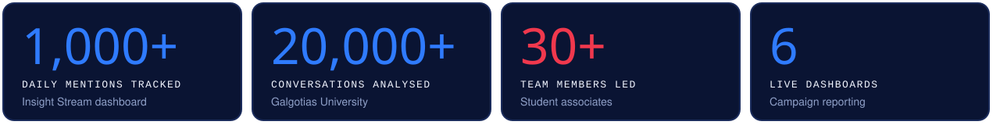

