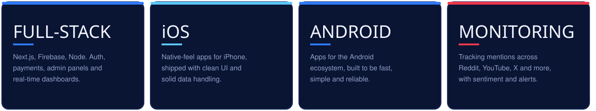
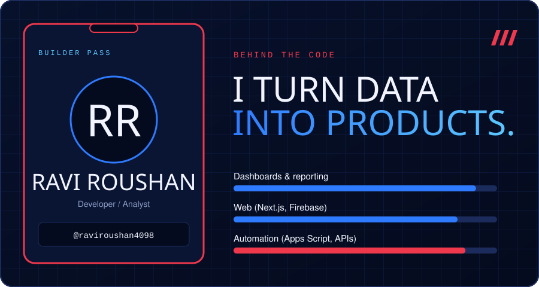

  
  
  
  

| Project | What it does | Stack |
|---|---|---|
| **[Insight Stream (ORM Tools)](https://ormtools.vercel.app)** | Unified dashboard tracking 1,000+ daily mentions across Reddit, YouTube, Instagram and LinkedIn, with AI sentiment, auto alerts, YouTube video analysis and NLP reports | Next.js, Firebase, Node.js, AI APIs |
| **[GoAalsi](https://www.goaalsi.com/)** | E-commerce platform with OTP-verified COD, Razorpay, an admin panel and stock checks that prevent overselling | Next.js, TypeScript, Firebase, Tailwind |
| **Sheets Monitoring Extension** | Pulls Reddit and Instagram data into Google Sheets with engagement and sentiment fields, cutting manual reporting by 70% | Google Apps Script, JavaScript |
| **Team Management Platform** | Internal tool for task assignment, targets, attendance and performance tracking for a 30+ person monitoring team | Web app |

 

  

  

  
  

  

  Open to full-stack, mobile and analytics roles. 
  <a href="mailto:raviroushan4098@gmail.com">raviroushan4098@gmail.com</a> · <a href="https://linkedin.com/in/ravi-roushan-187625222/">LinkedIn</a> · <a href="https://github.com/raviroushan4098">GitHub</a>

